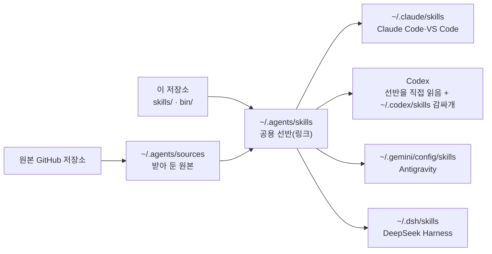

# agent-workbench

여러 AI 코딩 도구(Claude Code·VS Code, Codex, Antigravity, DeepSeek Harness)에서 **같은 스킬을 같은 이름으로** 쓰게 맞춰 주는 작업환경 꾸러미입니다. 스킬을 한곳(`~/.agents`)에 모아 두고, 도구마다 읽는 자리에 연결과 이름을 자동으로 맞춥니다.

- 외부 스킬(gstack, Superpowers, pstack 등)은 이 저장소에 복사해 싣지 않고 **원본 GitHub 저장소에서 받습니다.**
- 설치는 먼저 **할 일을 보여 주기만** 하고, `--apply`를 붙였을 때만 실제로 바꿉니다.
- 만든 것은 모두 기록해 두었다가 `./uninstall.sh`로 되돌릴 수 있습니다. 원래 있던 파일과 설정은 덮어쓰지 않습니다.

## 들어 있는 것

| 구성 | 하는 일 |
|---|---|
| 설치·점검·제거 (`install.sh`, `doctor.sh`, `uninstall.sh`) | 외부 스킬 받기, 연결, 도구별 이름 맞추기, 상태 점검, 되돌리기 |
| 동기화 도구 5개 (`bin/`) | `pack-prefix-sync`(Claude·Codex), `antigravity-sync-skills`, `dsh-sync-skills`, `gstack-sync-links`, `skill-inventory`(도구별 스킬 목록 HTML) |
| 직접 만든 스킬 18개 (`skills/`) | UI 검수(`ui-visual-qa` 등), 접근성(`wcag22-vibe-coding`), 한국어 글쓰기, Cloudflare 운영·비용 점검, 스킬 고르기(`skill-router`) 등. 목록은 [manifest/own-skills.json](manifest/own-skills.json) |
| DeepSeek Harness 플러그인 3개 (`dsh-plugins/`, 선택) | `skill-hints`(입력창 힌트), `agy-commands`(Antigravity식 `/agy` 명령), `brave-search`(Brave 검색, 자기 API 키 필요) |
| 지침 틀 (`templates/`, 선택) | 전역 `CLAUDE.md`와 `AGENTS.md` 시작용 틀(한국어로 답하기, 작게 고치기, 스킬 하나만 고르기 등) |

## 묶음 스킬의 이름: `<팩>-<이름>`

gstack·Superpowers·pstack처럼 여러 스킬을 묶은 팩은 사람이 부를 때 이름 앞에 팩 이름이 붙습니다. 어느 도구에서든 같습니다.

| 원래 이름 | 사람이 부르는 이름 |
|---|---|
| `browse` (gstack) | `/gstack-browse` |
| `brainstorming` (Superpowers) | `/superpowers-brainstorming` |

- Claude Code·VS Code·DeepSeek Harness: 원래 이름은 모델이 스스로 부를 때만 쓰도록 숨겨 둡니다.
- Codex·Antigravity: 숨김 기능이 없어서 말머리 이름 하나만 둡니다.

## 준비물

- macOS(리눅스는 시험하지 않음), `git`, `python3` 3.8 이상. 없으면 터미널에서 `xcode-select --install`.
- 연결할 AI 도구를 **먼저 설치하고 한 번 실행**해 두세요. 설치기는 있는 도구에만 연결합니다(`~/.claude`, `~/.codex`, `~/.gemini`, `~/.dsh`).
- gstack을 쓰려면 [bun](https://bun.sh). 없으면 gstack만 건너뜁니다.

## 설치

```bash
git clone https://github.com/LYNGMN/agent-workbench.git ~/agent-workbench
```

```bash
cd ~/agent-workbench && ./install.sh
```

위 명령은 할 일만 보여 줍니다. 내용을 보고 괜찮으면 실제로 적용합니다.

```bash
./install.sh --apply
```

설치가 끝나면 AI 도구를 다시 시작하세요.

### 더 넣을 것 고르기 (`--with`)

| 이름 | 넣는 것 |
|---|---|
| (기본) | Superpowers, gstack, pstack, Karpathy 지침 + 직접 만든 스킬 + 동기화 도구 |
| `extra` | Cloudflare 공식 스킬, Trail of Bits 보안 검토, OWASP, VibeSec, impeccable, taste-skill 등 |
| `catalog` | 보관만 하는 큰 카탈로그 2개(ECC 약 120MB, 보안 카탈로그 약 60MB) |
| `dsh-plugins` | DeepSeek Harness 플러그인 3개 |
| `templates` | 전역 지침 틀. **이미 지침 파일이 있으면 덮어쓰지 않습니다** |
| `all` | 위 전부 |

```bash
./install.sh --apply --with extra,dsh-plugins
```

### gstack 브라우저

gstack의 브라우저 스킬(`/gstack-browse`, `/gstack-qa` 등)은 실행 파일을 빌드해야 동작합니다. 설치기가 bun으로 함께 빌드하며 몇 분 걸립니다. 건너뛰려면 `--no-gstack-build`, 나중에 하려면:

```bash
cd ~/.agents/sources/garrytan/gstack && bun run build
```

## 점검

```bash
./doctor.sh
```

| 결과 | 뜻 |
|---|---|
| `ready` (종료 코드 0) | 바로 쓸 수 있음 |
| `action-required` (1) | 할 일이 있음(예: gstack 브라우저 빌드, PATH 추가) |
| `blocked` (2) | 먼저 고쳐야 함(예: git 없음, 저장소 폴더를 옮김) |

`~/.agents/bin`을 PATH에 넣으면 동기화 도구를 짧은 이름으로 부를 수 있습니다(선택).

```bash
echo 'export PATH="$HOME/.agents/bin:$PATH"' >> ~/.zshrc
```

## 업데이트

```bash
cd ~/agent-workbench && git pull && ./install.sh --apply
```

이미 받아 둔 외부 원본은 그대로 둡니다. `./doctor.sh`가 어떤 원본을 "시험한 커밋과 다름"으로 보이면, 그 원본 폴더를 지우고 설치를 다시 돌려 시험한 커밋으로 받습니다(원본을 직접 고쳤다면 먼저 따로 보관하세요).

```bash
rm -rf ~/.agents/sources/<만든 곳>/<이름> && ./install.sh --apply
```

스킬을 직접 더하거나 지웠으면 동기화 도구를 다시 돌립니다.

```bash
~/.agents/bin/pack-prefix-sync --apply
```

```bash
~/.agents/bin/antigravity-sync-skills --apply
```

```bash
~/.agents/bin/dsh-sync-skills --apply
```

도구별로 어떤 스킬이 어떤 이름으로 보이는지 한 장으로 보려면 `~/.agents/bin/skill-inventory`를 돌리고 `~/.agents/skill-inventory.html`을 엽니다.

## 제거

```bash
./uninstall.sh
```

할 일만 보여 줍니다. 실제로 지우려면 `--apply`를 붙입니다. 받아 둔 외부 원본(`~/.agents/sources`)까지 지우려면 `--purge-sources`도 붙입니다(받은 뒤 고친 원본은 남깁니다).

```bash
./uninstall.sh --apply
```

설치 기록(`~/.agents/.workbench/state.json`)에 적힌 것과 동기화 도구가 표시를 남긴 파일만 지웁니다. Claude `skillOverrides`, Codex `config.toml`, DeepSeek Harness 프로필은 설치 전 값으로 돌려놓습니다. 설치 뒤 고친 지침 파일은 남깁니다.

## 어디에 무엇이 생기나



| 자리 | 내용 |
|---|---|
| `~/.agents/sources/<만든 곳>/<이름>` | 외부 원본 저장소(시험한 커밋으로 받음) |
| `~/.agents/skills` | 실제로 쓸 스킬의 링크 모음(선반) |
| `~/.agents/bin` | 동기화 도구 링크 |
| `~/.claude/skills`, `~/.codex/skills`, `~/.gemini/config/skills`, `~/.dsh/skills` | 도구별 링크와 말머리 감싸개 |
| `~/.agents/.workbench/state.json` | 설치 기록(제거할 때 씀) |

이 저장소 폴더는 설치 뒤에도 지우지 마세요. 직접 만든 스킬과 도구가 이 폴더를 가리킵니다. 옮기거나 지우려면 먼저 `./uninstall.sh --apply`.

## 기본값 바꾸기

`~/.config/agent-workbench/config.json`에 [config/defaults.json](config/defaults.json)과 같은 이름의 칸을 적으면 그 칸이 통째로 바뀝니다. 예를 들어 Antigravity에서 빼는 스킬 목록(`antigravity_skip`, Antigravity는 스킬 설명을 약 32KB까지만 싣습니다)이나 Claude에서 처음에 끄는 스킬(`claude_overrides_preset`, 기본은 `using-superpowers`만 끔)을 바꿀 수 있습니다.

## 알아 둘 점

- 스킬은 AI에게 주는 작업 지시문입니다. 외부 스킬은 각 원본 저장소의 내용이 그대로 쓰이니, 원본이 믿을 만한지 직접 판단하세요. 이 저장소는 어느 커밋을 받을지 [manifest/sources.json](manifest/sources.json)에 고정해 둡니다.
- 이 저장소에는 API 키·토큰이 들어 있지 않습니다. `brave-search` 플러그인은 자기 키를 넣어야 동작합니다([dsh-plugins/brave-search/README.md](dsh-plugins/brave-search/README.md)).
- OpenCode는 아직 연결하지 않습니다.

## 시험

```bash
test/install-test.sh
```

빈 임시 HOME 두 개(도구 네 개가 다 있는 맥, Claude만 있는 맥)에 미리보기 → 설치 → 다시 돌려도 바꿀 것 없음 → 점검 → 제거 뒤 설치 전과 같음을 확인합니다. 실제 HOME은 건드리지 않습니다.

## 라이선스와 출처

이 저장소의 코드와 직접 만든 스킬은 [MIT](LICENSE)입니다. 받아 쓰는 외부 스킬과 함께 실은 데이터의 출처·라이선스는 [THIRD_PARTY.md](THIRD_PARTY.md)에 있습니다.
