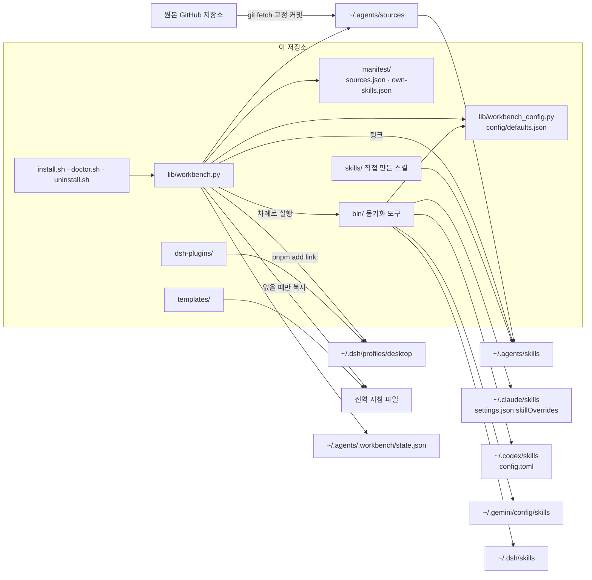
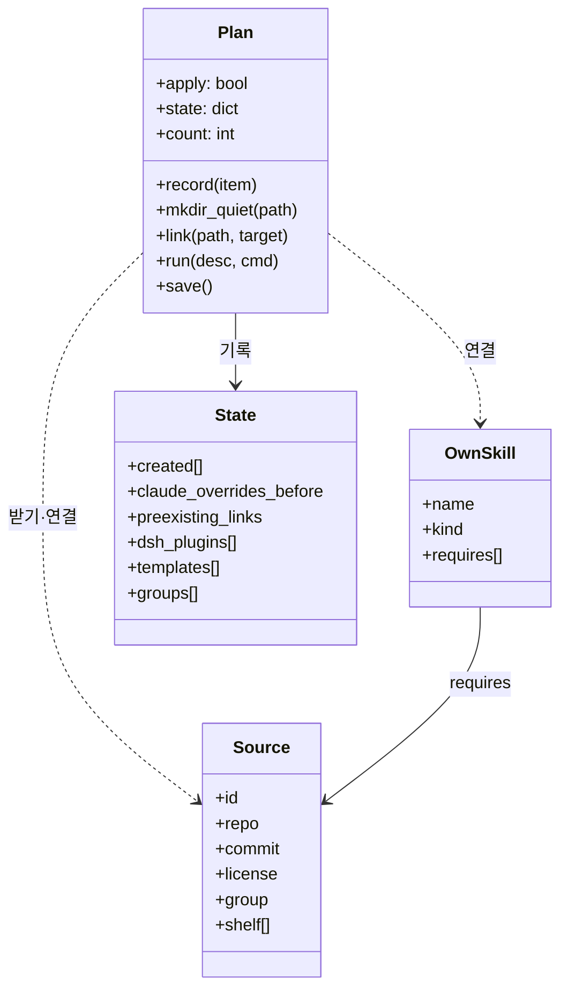
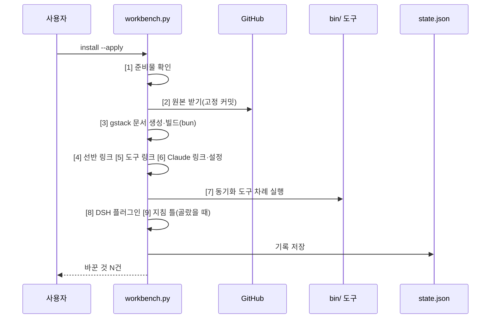

# agent-workbench 구조

## 1. 연결 구조

| 부품 | 이어지는 곳 | 방법 |
|---|---|---|
| `install.sh` 등 | `lib/workbench.py` | `python3`로 실행만 넘김 |
| `lib/workbench.py` | 원본 GitHub 저장소 | `git init` + `git fetch --depth 1 <주소> <커밋>`, 안 되면 전체 fetch |
| `lib/workbench.py` | `~/.agents/skills` | 원본은 상대 링크, 직접 만든 스킬은 이 저장소로 가는 절대 링크 |
| `lib/workbench.py` | `bin/` 동기화 도구 | 하위 프로세스로 `--apply` 실행 |
| `bin/` 동기화 도구 | 도구별 스킬 폴더 | 링크, 또는 MARK 주석을 단 감싸개 `SKILL.md` |
| `lib/workbench.py` | DeepSeek Harness 프로필 | DSH에 들어 있는 node·pnpm으로 `add link:` |
| `lib/workbench.py` | `state.json` | 만든 것과 바꾸기 전 값을 기록 |

## 2. 책임 나누기

| 부품 | 맡는 일 | 맡지 않는 일 |
|---|---|---|
| `lib/workbench.py` | 원본 받기, gstack 문서 생성·빌드, 선반·도구·Claude 링크, 동기화 도구 차례 실행, 플러그인·지침 틀 설치, 점검, 기록대로 제거 | 도구별 이름 규칙(동기화 도구가 맡음) |
| `lib/workbench_config.py` | 경로(`$HOME` 기준), 설정 합치기, MARK 문구, "이 패키지가 관리하는 자리" 판단 | 파일 쓰기 |
| `bin/pack-prefix-sync` | Claude: 말머리 감싸개 + 원래 이름 `user-invocable-only`. Codex: `~/.codex/skills` 감싸개 + `config.toml` 자동 블록 | 다른 도구 |
| `bin/antigravity-sync-skills` | 선반을 한 단계로 펼쳐 `~/.gemini/config/skills`에 링크, 팩은 말머리 감싸개, 목록 예산 넘는 것은 뺌 | Claude·Codex |
| `bin/dsh-sync-skills` | `~/.dsh/skills`에 pstack 링크와 팩 말머리 감싸개 | 선반 자체(DSH가 직접 읽음) |
| `bin/gstack-sync-links` | gstack이 만든 문서를 선반 `gstack/`과 `~/.claude/skills`에 연결 | gstack 문서 생성 |
| `bin/skill-inventory` | 도구별로 보이는 스킬 이름을 HTML 한 장으로 | 고치기 |
| `manifest/` | 받을 원본·커밋·라이선스·선반 자리, 직접 만든 스킬 목록과 필요한 원본 | 실행 |
| `config/defaults.json` | 팩 이름, 도구별 빼는 목록, Claude 처음 설정 | 사용자 파일 경로 |

## 3. 객체 관계

| 객체 | 갖는 것 | 관계 |
|---|---|---|
| `Plan` | 미리보기인지 적용인지, 상태, 바꾼 수 | 모든 쓰기는 `Plan`을 거친다. 미리보기면 출력만 한다 |
| `Source` | `manifest/sources.json`의 한 줄 | `group`(core·extra·catalog)이 `--with`로 골라졌을 때만 받는다 |
| `OwnSkill` | `manifest/own-skills.json`의 한 줄 | `requires`의 원본이 모두 있을 때만 선반에 건다 |
| `State` | 아래 5절 | 제거기가 이것만 보고 되돌린다 |

## 4. 요청 순서: `./install.sh --apply`

| 단계 | 하는 일 |
|---|---|
| 1 | python·git·bun과 설치된 도구 확인 |
| 2 | 골라진 원본을 받는다. 이미 있으면 그대로 둔다 |
| 3 | gstack 문서 생성, 브라우저 빌드(실패해도 계속), 실행 파일 자리(`gstack-runtime`) |
| 4–6 | 링크를 건다. 다른 것이 이미 있으면 건너뛰고 알린다 |
| 7 | 도구별 이름 맞추기 |
| 8–9 | `--with`로 골랐을 때만 |

## 5. 데이터 관계: 상태 파일

`~/.agents/.workbench/state.json` 한 파일입니다.

| 칸 | 내용 | 제거할 때 |
|---|---|---|
| `created[]` | `{kind: link·dir·clone, path, …}` 만든 차례대로 | 거꾸로 지운다. 폴더는 비었을 때만, 원본은 `--purge-sources`이고 고친 것이 없을 때만 |
| `claude_overrides_before` | 설치 전 Claude `skillOverrides` | 이 패키지가 다룬 칸만 이 값으로 되돌린다 |
| `claude_settings_existed` | 설치 전에 `settings.json`이 있었나 | 없었고 지금 비었으면 파일을 지운다 |
| `preexisting_links` | 설치 전 도구 폴더에 있던 링크 이름 | 이 이름은 지우지 않는다 |
| `dsh_plugins[]` | 설치한 DSH 플러그인 | 프로필 `bundles`에서 빼고 `pnpm remove` |
| `templates[]` | `{path, sha256}` | 해시가 같을 때만 지운다 |
| `agents_existed` | 설치 전에 `~/.agents`가 있었나 | 없었으면 비었을 때 지운다 |
| `groups[]`, `repo` | 고른 묶음, 설치한 저장소 위치 | 점검이 쓴다 |

## 6. 지킬 경계

- 쓰기는 모두 `Plan`(설치기) 또는 각 동기화 도구의 `--apply` 안에서만 한다. 미리보기 경로에서 파일을 만들지 않는다.
- 동기화 도구는 MARK 주석이 있는 감싸개와 `managed_roots()` 안을 가리키는 링크만 고치거나 지운다. 사용자가 직접 만든 스킬·링크는 건드리지 않는다.
- 기존 사용자 파일은 덮어쓰지 않는다. 지침 틀은 대상이 없을 때만 복사한다.
- 외부 원본 내용은 이 저장소에 싣지 않는다. 감싸개는 원본 경로만 가리킨다.
- 비밀값을 읽거나 쓰지 않는다. DSH의 Brave 키는 사용자가 넣는다.

## 7. 고치는 때

책임·경계·상태 파일 칸을 바꾸는 PR이 이 문서를 같이 고칩니다.
