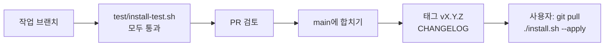

# 작업·배포 흐름

이 저장소는 서버에 배포하는 서비스가 아니라, 사용자가 `git clone`으로 받아 자기 맥에 설치하는 꾸러미입니다. "배포"는 `main`에 합치고 버전 태그를 붙이는 일입니다.

| 질문 | 답 |
|---|---|
| 1. 검토는 누가 하나요? | 고친 도구가 아닌 다른 도구·세션이나 저장소 주인이 PR을 읽습니다. 외부 기여 PR은 저장소 주인이 검토합니다. |
| 2. 넓은 검사는 어디서 몇 번 돌리나요? | 합치기 전 작업 브랜치에서 `test/install-test.sh` 한 번(3분 남짓). 임시 HOME 두 개에 설치·재실행·점검·제거를 돌립니다. 외부 원본은 `~/.agents/sources`에 있으면 그 사본을 쓰고, 없으면 GitHub에서 받습니다(`--with all`이라 처음에는 약 200MB). |
| 3. 병합·배포 실행기와 명령은? | 별도 실행기는 없습니다. GitHub에서 PR을 합친 뒤 `git tag -a vX.Y.Z -m "<요약>"`, `git push origin vX.Y.Z`. |
| 4. 누가 병합·배포하나요? | 저장소 주인. AI 도구는 PR까지 만들고, 합치기·태그는 주인의 승인 뒤에만 합니다. |
| 5. 사용자 승인이 필요한 일은? | 원격에 처음 올리기, 공개·비공개 전환, `main`에 합치기, 태그, 강제 Push, 외부 원본의 고정 커밋 올리기(새 내용을 사용자 맥에 싣는 일). |
| 6. 운영 확인은 무엇을 대조하나요? | 합친 뒤 빈 임시 HOME에서 GitHub 주소로 `git clone` → `./install.sh --apply` → `./doctor.sh`가 `ready` 또는 gstack 브라우저 빌드만 남는지 봅니다. |
| 7. 기록은 어디에 남기나요? | [CHANGELOG.md](../CHANGELOG.md)(판별), Git 태그, PR 설명. |
| 8. 되돌릴 때는? | 문제 커밋을 `git revert`하는 PR을 만들어 합치고 새 태그를 붙입니다. 이미 설치한 사용자는 `git pull && ./install.sh --apply`. 설치 자체를 되돌리려면 `./uninstall.sh --apply`. |

## 외부 원본의 고정 커밋 올리기

1. 원본의 새 커밋에서 바뀐 내용(특히 `SKILL.md`)을 읽습니다. 스킬은 AI에게 주는 지시문이라, 낯선 명령 실행·외부 전송·비밀값 읽기가 새로 생겼는지 봅니다.
2. [manifest/sources.json](../manifest/sources.json)의 `commit`을 바꾸고 라이선스가 그대로인지 확인합니다.
3. `test/install-test.sh`를 돌립니다. gstack을 올렸으면 `bun run build`도 한 번 봅니다.
4. CHANGELOG에 "원본 올림: <이름> <옛 커밋 앞 8자> → <새 커밋 앞 8자>"를 적습니다.

이미 받아 둔 원본은 설치기가 바꾸지 않습니다. 이미 설치한 사용자는 `./doctor.sh`에서 "시험한 커밋과 다름"을 보고, README "업데이트"의 방법으로 옮깁니다.
